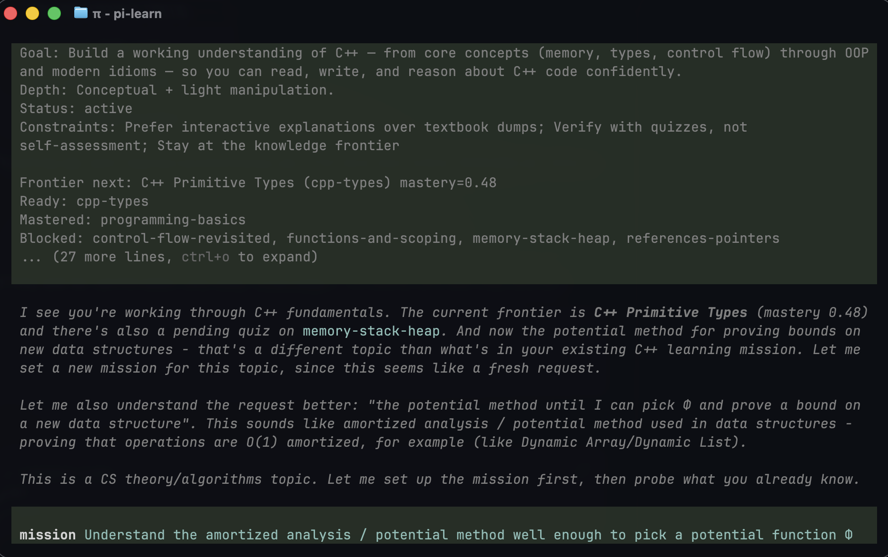

# pi-learn

`pi-learn` is a project-local adaptive tutor for Pi. It builds a small learning plan, teaches one concept at a time, checks understanding with a quiz, and saves evidence so the next session can continue.

Chat history is not the learner model. Progress lives in files in this repository.



## Prerequisites

- Node.js 22.19 or newer
- Pi 1.6 or newer (`@earendil-works/pi-coding-agent`)
- `pi-subagents` 0.90 or newer
- `pi-web-access` 0.48 or newer

## Setup

Install Pi and the extensions, then start Pi from this repository:

```bash
curl -fsSL https://pi.dev/install.sh | sh
pi install npm:pi-subagents
pi install npm:pi-web-access

git clone https://github.com/arnavprabhu/pi-learn.git
cd pi-learn
npm install
pi --approve
```

The installer pins Pi's dependencies, and `pi update` keeps it current. To install from npm instead, run `npm install -g --ignore-scripts @earendil-works/pi-coding-agent`. Update the extensions with `pi update --extensions`.

`--approve` trusts this project so Pi can load its local skills, extensions, agents, and settings. Pi may prompt for this approval interactively instead.

## Models

pi-learn works with every model provider Pi supports. Sign in through Pi, or run locally with [Ollama](https://docs.ollama.com/integrations/pi). A 12B-class model or larger is enough to get started. With Ollama, that path is free and stays on your machine.

## Everyday use

```text
/teach Riemann sums
/frontier
/map
/recap
```

`/teach` with no topic resumes the current mission. You can also ask in plain language: `Teach me how Riemann sums approximate area.`

`/frontier` prints the next concept from saved files, not from chat. When a mission is active, the footer shows the goal, the next concept id, and how many reviews are due.

`/map` opens the concept map: every concept in prerequisite order with its mastery bar, the next concept (▶), reviews due (↻), and open misconceptions (!). Move with the arrow keys to see a concept's details.

`/recap [days]` summarizes the last 7 days, or the number you give: accuracy, newly mastered concepts, forgotten ones, misconceptions found and resolved, and what's due next. It is computed from the evidence log, with no model call, and saved to `learning-records/recap-YYYY-MM-DD.md`. You can also ask the tutor how you are doing.

If `/teach` asks you to wait, let the current turn finish first.

### Quizzes

Checks appear as a quiz overlay, not as “does that make sense?” **I don't know** is always an option and is better than guessing. The answer key is never shown in the UI.

| Format | You answer with | Graded by |
|--------|-----------------|-----------|
| Multiple choice | a list | script |
| Multi-select | a checklist (space toggles, enter submits) | script, with partial credit |
| Numeric | a number (`1/3`, `6.02e23`, `25%`, and units are fine) | script, within a tolerance |
| Code | a short JavaScript or Python function | your code is run against hidden tests (10 s limit) |
| Free response | a short editor | an isolated verifier model |

The tutor prefers script-graded formats when an answer has one checkable form, because they don't depend on a model's judgment. Code answers run on your machine with your permissions, like any code you run yourself. Python needs `python3`, or set `PI_TEACH_PYTHON`.

### Reviews and misconceptions

Mastered concepts come back for review on a spaced schedule: about a day after you first get one right, then at growing intervals each time you recall it after a gap. Forgetting shortens the interval. Each session starts with up to three due reviews before new material.

Misconceptions the grader finds are tracked one by one. The tutor later writes an item aimed at each one. Getting it right marks it resolved, and getting it right again at least two days later confirms it. If it shows up again, it reopens.

### Your sources

Put readings, notes, code, or textbooks in `knowledge/`, then `/teach` again. Pi indexes changed files, searches relevant passages, and keeps a local cache. An empty folder is fine.

PDF, Markdown, text, HTML, JSON, CSV, and common source-code files are supported. PDF extraction is local and does not use OCR. Passages are ranked with BM25, which favors rare, specific terms over words that appear everywhere. `knowledge/README.md` is a guide for you and is not indexed as a source.

Files in `knowledge/` are tracked by Git by default. Uncomment the knowledge rules in `.gitignore` if the material should stay local.

## How it works

```text
Review → Probe → Plan → Teach → Verify → Persist
```

The tutor first reviews anything due, then finds the nearest unmastered concept (the frontier), teaches that one step, and quizzes. “I get it” is not treated as evidence. A later session reads the same files and continues there.

When your sources don't cover a new topic, the researcher starts in the background as soon as the mission is set. The tutor drafts a provisional concept graph and starts probing meanwhile, then folds the research in when it arrives.

## Where progress lives

| File | Role |
|------|------|
| `MISSION.md` | Current goal and depth cap |
| `learner/evidence.jsonl` | Canonical evidence log |
| `learner/concepts.json` | Derived cache: mastery, review schedule, open misconceptions |
| `learning-records/` | Compact daily notes and `/recap` summaries |
| `knowledge/` | Your source material |
| `.pi/knowledge-cache/` | Generated local index |

Optional steering: `learner/profile.md` and `learner/preferences.md`. The tutor also writes `MISSION.md` when a topic starts.

## Reset

Resets are never automatic. They ask for confirmation and keep `knowledge/`, its cache, and learning records.

```text
/teach-reset topic <id>
/teach-reset mission
/teach-reset all
```

CLI equivalents:

```bash
npm run reset -- --topic riemann-sums
npm run reset -- --mission
npm run reset -- --all --yes
```

## Isolation

Skills, extensions, agents, sessions, and learner state live in this repository. The project does not install anything into `~/.pi/` or use global Pi sessions. Pi itself may update its trust file if you approve the project. The researcher uses `pi-subagents` and `pi-web-access`; the tutor does not browse directly. The researcher runs as a background subagent because only background subagents load `pi-web-access`. The tutor picks up its findings when it finishes.

## Tests

```bash
npm test
```

Tests use Node's built-in test runner and TypeScript's native type stripping.

## Project layout

```text
.pi/                 project-local Pi configuration and tutoring logic
knowledge/           learner-provided source material
lib/                 inspectable mastery, graph, grading, and persistence code
learner/             saved learner state
learning-records/    session memory
scripts/reset.mjs    explicit learner-state reset CLI
tests/               automated tests
MISSION.md           current learning goal
```
